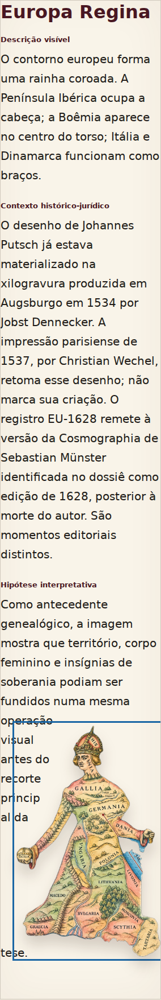
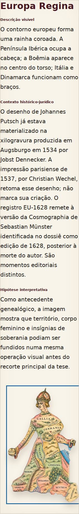

# Explore — responsividade e legibilidade (13/10/2026)

Base: `5a9240b093ccb6dfe582125a9f2e1cc32e365812`, `main` após a PR #165.
Rota: `/atlas/nacao-como-mulher/`. A revisão histórica e seu adendo permanecem intactos.

## Diagnóstico reproduzido

O teste anterior falhou exatamente com **1756 px**, esperado `<1500`, em 320 × 844 px: abrir Explorar, focar a figura, pressionar `-`, `+` 40 vezes e `ArrowDown` 150 vezes.

O elemento medido é **`.living-text`**, o palco que contém título, três camadas de texto e figura. Não é a altura da imagem: o botão da figura mede aproximadamente **253,80 × 407,05 px** nesse estado. O palco tem 284 px de largura (282 px úteis). O documento não apresenta overflow horizontal.

Mais 150 movimentos para baixo mantêm os mesmos 1756 px e a posição da figura: não há crescimento ilimitado. Entretanto, o algoritmo aceita intervalos a partir de 48 px ao redor do contorno. A ampliação comprime o texto em frestas e divide palavras, inclusive `principal` em `princip` / `al`. Também foi encontrada a divisão `espanhola` em `espanhol` / `a` no título de ES-002 em 390 px. Isso prejudica a leitura mesmo sem overflow da página. Movimentos repetidos por teclado podiam levar a figura para fora da viewport.

## Correção

- No Explore compacto (breakpoint existente de 620 px), a prosa exige intervalo de **180 px**, equivalente a nove ems do texto de 20 px, limitado à largura disponível. Onde não cabe uma frase curta ao lado da figura, o fluxo continua abaixo dela. Os títulos de 32 px usam a largura inteira do palco no mobile.
- `flowText` aceita largura mínima por fluxo e por bloco. O padrão de 48 px continua sendo usado no desktop e no modo de leitura desktop.
- Movimentos e dimensionamento por teclado no mobile acompanham a figura com rolagem, respeitando a borda inferior da toolbar fixa. Arraste e controles permanecem disponíveis.
- A altura continua derivada do conteúdo e da geometria, sem máximo que corte texto ou reduza artificialmente a tipografia. Não houve alteração de imagens, textos, metadados, semântica de leitura, idiomas ou estilos CSS.

## Teste substituto e controle negativo

O limite global `<1500` foi substituído por quatro casos (320/390 px × PT/EN) que verificam:

1. O texto visível recomposto corresponde ao texto semântico completo, sem perda nem separação indevida de palavras. Quebras após hífen existente, como `EU-1628`, são permitidas.
2. Texto e figura ficam dentro do palco; o documento não transborda horizontalmente.
3. Movimentos adicionais após alcançar o limite não alteram a posição nem aumentam a altura.
4. Teclado: ativação de Explore com Enter, Tab e Shift+Tab nos controles, redução, ampliação, movimento, alternância de prancha e reposição. A figura permanece visível abaixo da toolbar após os movimentos.
5. Prancha integral sem sobreposição de texto; resize 320 → 390 → 320 e 390 → 320 → 390 conserva foco e prancha selecionada.
6. Abertura de Fonte e direitos por teclado e seleção das nove fichas com Tab/Enter, com nova verificação de legibilidade em cada uma.

**Controle negativo:** o novo caso 320/PT foi executado contra o bundle de `main` anterior à correção. Falhou na igualdade entre texto visível e semântico após ampliação/movimento, por quebra de palavra. Passa com a correção. Portanto, não se trata apenas de remover uma asserção inconveniente.

## Medidas e verificação visual

Europa Regina, PT, viewport com altura de 844 px; estado final após ampliar e mover até a borda inferior. As medidas são observações deste ambiente, não novos limites de teste.

| Viewport | Palco antes | Palco depois | Após mais 150 movimentos | Overflow horizontal |
|---|---:|---:|---|---:|
| 320 px | 1756 px | 1822 px | Altura e figura estáveis | 0 px |
| 390 px | 1586 px | 1670 px | Altura e figura estáveis | 0 px |
| 1280 px | 845,64 px | 845,64 px | Altura e figura estáveis | 0 px |

O pequeno aumento de altura no mobile acomoda palavras inteiras e a figura. A redução do número de linhas estreitas melhora a leitura. Rolagem vertical faz parte dessa apresentação e não é confundida com overflow horizontal.

Em **1280 px**, os pixels do palco são idênticos antes/depois nos seis estados: inicial, ampliado, limite inferior, tentativa adicional de movimento, prancha integral e reposição. Altura inicial desktop: 634 px em ambas as versões. [Medidas, posições e hashes das capturas](qa/explore-responsive-20261013/measurements.json).

As capturas abaixo isolam o palco: a opção `style` de `locator.screenshot` torna site-bar e toolbar invisíveis **somente durante a captura**, para não sobrepor as barras fixas no meio de uma imagem longa. Os testes de teclado, visibilidade e overflow usam as barras normais, sem esse estilo. Capturas produzidas por Chromium; não são imagens reconstruídas.

| 320 px — antes | 320 px — depois |
|---|---|
|  |  |

[390 px corrigido](qa/explore-responsive-20261013/390-after.png) · [Desktop antes](qa/explore-responsive-20261013/1280-before.png) · [Desktop depois](qa/explore-responsive-20261013/1280-after.png).

## Validação executada

| Verificação | Resultado |
|---|---|
| Página correta, conteúdo renderizado, ausência de tela de erro | Aprovado na rota local |
| Exceções JavaScript durante o roteiro visual | Nenhuma |
| Playwright da exposição, sem as três integrações externas | **15 aprovados** |
| Mobile PT/EN, resize, teclado e nove fichas | Aprovado |
| Overflow horizontal de leitura em 320/390/768/1280 px | Aprovado |
| Arraste desktop, toque em 390 px, comparação, filtros, idioma e leitura sem JS | Aprovado |
| TypeScript, Vitest, nove registros e dois snapshots documentais | **6 testes unitários aprovados**, dados válidos |
| Build e pré-renderização | Aprovado |
| Comparação visual desktop | 6/6 estados com pixels idênticos |
| `git diff --check` | Aprovado |

Ambiente: Linux, Node 24.19.0, Playwright 1.62.1 e Chromium 153.0.8010.0 (`@sparticuz/chromium` instalado fora do projeto). Browser plugin não disponível; usado Playwright. O download padrão do Chromium retornou ZIP truncado. O `http-server` falhou em `os.networkInterfaces`, então a configuração local temporária usou `python -m http.server 8080 --bind 127.0.0.1` e `launchOptions.executablePath = '/tmp/chromium'`. Nenhuma dependência ou configuração do projeto foi alterada para acomodar o ambiente. As fontes globais e os 18 arquivos de imagem foram recuperados e verificados; os avisos do Vite sobre `/fonts/` não impedem sua resolução no servidor da raiz.

Comandos (o override local só adapta servidor/binário e mantém a configuração da suite):

```sh
npm run check:exhibition
npm run build:exhibition
npx playwright test --config=../playwright.local.cjs tests/nacao-como-mulher.spec.js --grep-invert 'Trabalhos|the Atlas advertises|Atlas cards preserve'
git diff --check
```

Em checkout completo com Chromium instalado, pode-se usar `npx playwright test tests/nacao-como-mulher.spec.js` com a configuração normal. Não se declara execução das três integrações Trabalhos/Atlas ausentes no checkout parcial, de Firefox/WebKit, de leitor de tela real ou de dispositivos físicos. A edição sem JavaScript foi testada. A renderização de fontes pode variar entre sistemas; por isso, a altura não é uma constante universal.

O JSON histórico, as 18 imagens de origem e suas 18 cópias de saída, os contornos, o CSS e o adendo da PR #165 não entram nas alterações. O bundle é regenerado e sua referência no HTML é atualizada. A PR não efetua merge nem publicação em produção.
